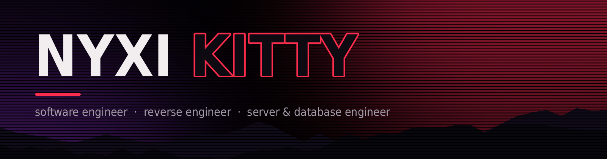

<div align="center">




</div>

## Hey, I'm Nyxi

Also known as **Nyxi Kitty**. I build things that talk over the wire, take apart things that weren't meant to be opened, and keep servers and databases standing when people pile onto them.

Lately that means **modding Unity games that run in the browser**: reading IL2CPP metadata and WebAssembly at runtime until a compiled game behaves like a scriptable one.

- **Software engineering:** tools, games, bots and desktop and mobile apps
- **Reverse engineering:** figuring out how closed software, runtimes and protocols actually work
- **Servers and databases:** backends, APIs and the data layer underneath them
- **Best at:** networking, especially **multiplayer networking**

## Featured

### 🍌 BananaLoader

**MelonLoader for Unity WebGL games.** Mods are JavaScript files called *Banans*. Drop one in and it hooks the game's lifecycle, patches IL2CPP methods Harmony-style and reads and writes game objects like C#.

```js
module.exports = class FreeCam extends Banan {
  onUpdate() {
    Camera.main.transform.Rotate(0, 90 * Time.deltaTime, 0);
  }
};
```

- **Interop:** game types and objects as JS proxies, so `Camera.main.transform.position` and `Time.timeScale = 0.5` just work, generics included (`List<int>`, `GetComponent<T>()`)
- **Patching:** prefixes and postfixes on any method, including non-virtual calls the game makes directly. The game's wasm is rewritten at load time to make that possible
- **Editor:** built-in Banan editor with syntax highlighting, IntelliSense from the game's metadata, and hot reload on <kbd>Ctrl</kbd>+<kbd>S</kbd>
- **Coverage:** Unity 2018.1 → 6000, IL2CPP metadata v24.0 → v31, both of Unity's WebGL toolchains (Emscripten fastcomp and LLVM)

<!-- add the repo link: [BananaLoader](https://github.com/oddnyxi/...) -->
[](https://discord.gg/bananaloader)

### 🔍 Unity Explorer

**An in-game object explorer for Unity WebGL (IL2CPP) games**, as a userscript. It gives you a scene hierarchy, a click-to-select picker and a live inspector for fields, properties and methods. There's also a class browser for every type in the build, and a JavaScript console with IntelliSense where game types work by name.

<!-- add the repo link: [Unity Explorer](https://github.com/oddnyxi/...) -->

### Under the hood

Both tools share one engine I wrote from scratch, with no dependencies:

| | |
|---|---|
| **IL2CPP bridge** | Parses `global-metadata.dat` (v24.0 – v31), finds code and metadata registration in the heap, and calls managed methods with the right ABI for each toolchain |
| **WebAssembly** | Reads the module's function tables and invoker signatures to map every method to its real table slot, even on 2018-era asm2wasm builds |
| **Bootstrap** | Runs before the game's own scripts, watches the Unity loader, downloads and wasm compile, and shows an animated loading screen with a full boot report |
| **Odium Dumper** | Produces `dump.cs`, named wasm and `script.json` from a game running in the browser |
| **[Odium UI](https://github.com/oddnyxi/odium-ui)** | The black-and-red window toolkit everything above is drawn with |

Tested against public builds from Unity 2018.2 to 2023.1.

## Languages

<div align="center">


</div>

That's the whole list. I'd rather know a few things well than list fifty.

## What I'm good at

| | |
|---|---|
| **Multiplayer networking** | Netcode, lobbies, state sync, custom protocols, and how real players break all of it |
| **WebSockets** | Realtime servers, binary and JSON protocols, reconnects, backpressure |
| **Databases** | Schema design, queries and keeping them fast under load |
| **APIs** | Designing, building and consuming them, REST and beyond |
| **Reverse engineering** | Reading unknown binaries and traffic until the behavior makes sense |
| **Game runtimes** | IL2CPP, WebAssembly and Emscripten internals: metadata, calling conventions, function tables, hooking |

## Other things I've built

- **[Odium Launcher](https://github.com/oddnyxi/odium-launcher)**: a black-and-red Android home screen. Native `HOME` activity, WebView UI, pixel cat, weather and focus widgets.
- **[Odium Weather](https://github.com/oddnyxi/OdiumWeather)**: an Electron weather app ported to Android. React UI in a WebView, Open-Meteo forecasts and a live RainViewer radar.
- **FloofVR**: a social VR game in Godot 4 with a Bun and TypeScript multiplayer server.

## Find me

[](https://github.com/oddnyxi)
[](https://soundcloud.com/nyxikitty)
[](https://discord.com/users/383978230757195776)
[](https://discord.gg/bananaloader)

## Stats

<div align="center">


</div>

---

<div align="center"><sub>nyxi · black, red, and packets</sub></div>
